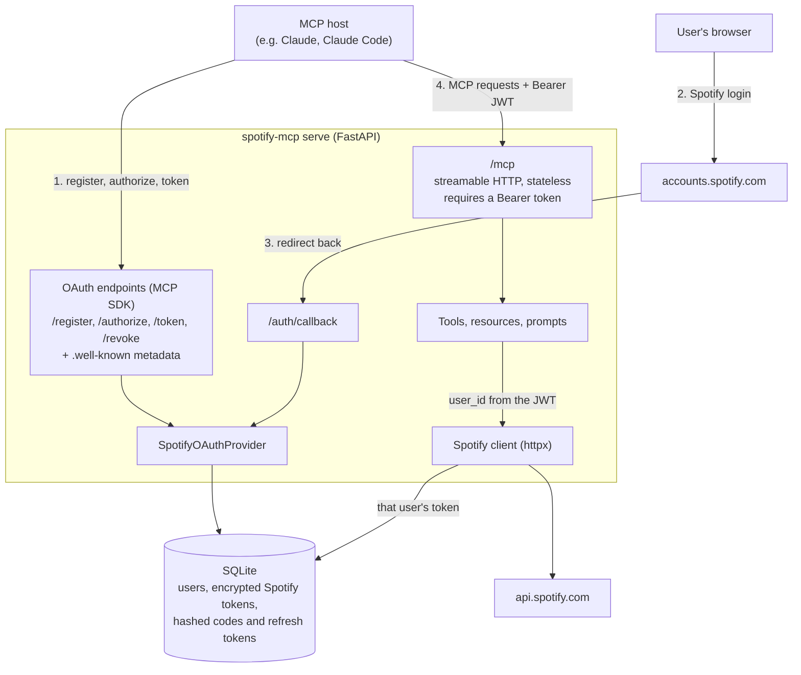

# spotify-mcp

[](https://github.com/Pacolias/spotify-mcp/actions/workflows/tests.yml)
[](LICENSE)

A remote MCP (Model Context Protocol) server for the Spotify Web API, built with Python and FastAPI. MCP hosts (Claude, Claude Code, ...) connect to it over HTTP, and users sign in by clicking "connect" and logging in to Spotify: no API keys to copy around.

This is a portfolio project by [Paco Molina](https://pacomolina.dev). The reasoning behind every architecture decision — and why — is logged in [`journal/`](journal/), one entry per decision, in the order they were made.

## Example

A real exchange with `import_youtube_playlist`, pulling new tracks from a YouTube mix's chapter list into an existing Spotify playlist (see [journal entry 24](journal/24-youtube-playlist-import.md) for the full story):

> **You:** Pull any new songs from this YouTube mix into my "Chill" playlist: youtube.com/watch?v=...
>
> **Claude:** *(calls `import_youtube_playlist`)* Found 14 tracklist entries in the video's chapters. 7 matched confidently on Spotify and were added; 7 were skipped — 4 pointed at the same wrong song (likely unreleased tracks not on Spotify), 2 didn't match any plausible artist, and 1 was a non-track marker ("LOOP"). Your playlist went from 3 to 10 tracks.

## How it works

[MCP](https://modelcontextprotocol.io/) is an open protocol that lets an AI client (like Claude) talk to external tools and data sources through a standard interface, instead of custom one-off integrations. A client connects to a server, and the server exposes three kinds of things: **tools** — functions the model actively decides to call, with a name, description, and typed schema generated from the function's signature and docstring; **resources** — read-only, URI-addressed data (e.g. `spotify://me/now-playing`) meant to be listed and attached to context more like a referenced document than an invoked action; and **prompts** — reusable prompt templates the host can surface directly to the user (often as a quick-access menu) that kick off a specific workflow with a pre-written message.

The server runs as a single HTTP service (`spotify-mcp serve`): a FastAPI app with the MCP SDK's app mounted inside it. It plays two roles:

- **MCP server.** `/mcp` speaks MCP over **streamable HTTP**, statelessly: every request stands alone, so the server can restart or run as several copies without breaking anyone's connection.
- **OAuth authorization server for MCP hosts**, following the MCP authorization spec. A host that gets a `401` from `/mcp` discovers the server's OAuth metadata, registers itself (dynamic client registration), and sends the user to `/authorize`. That chains straight into **Spotify's own login**, so signing in to this server *is* connecting Spotify. The host ends up with an access token (a signed JWT, valid for an hour) and a refresh token, and sends the access token with every MCP request.

Two OAuth flows are chained, and Spotify's tokens never leave the server:

```
MCP host ──(OAuth #1)──▶ this server ──(OAuth #2)──▶ Spotify
           we issue our own tokens       Spotify issues its tokens, kept server-side
```

Each tool call resolves the user from the access token's `sub` claim and calls Spotify with that user's tokens, so up to five people (Spotify's limit for apps in Development Mode) can use one deployment. Spotify tokens are stored **encrypted** in SQLite. Refresh tokens and authorization codes are stored only as **SHA-256 hashes**, and refresh tokens rotate on every use, with reuse detection.



### Available tools

| Tool | Description |
|---|---|
| `ping` | Health check — confirms the MCP server is reachable. |
| `search_track` | Search Spotify's catalog for tracks matching a query. |
| `now_playing` | Get the track currently playing on the logged-in user's account, if any. |
| `top_tracks` | Get the user's most-listened-to tracks (short/medium/long term). |
| `top_artists` | Get the user's most-listened-to artists (short/medium/long term). |
| `recently_played` | Get the user's most recently played tracks. |
| `list_user_playlists` | List the logged-in user's playlists. |
| `playlist_tracks` | List the tracks in a playlist. |
| `create_user_playlist` | Create a new playlist. ⚠️ `public=False` is currently ignored by a confirmed bug on Spotify's side — playlists are created public regardless. |
| `add_tracks` | Add one or more tracks to a playlist. |
| `remove_tracks` | Remove one or more tracks from a playlist. |
| `find_playlists` | Discover existing curated Spotify playlists matching a query (name/owner/description only — can't read tracks of playlists you don't own). |
| `import_youtube_playlist` | Build a new Spotify playlist from a YouTube video's tracklist (chapters/description — no audio recognition). ⚠️ Same `public=False` limitation as `create_user_playlist`. |
| `shuffle` | Turn shuffle mode on or off. |
| `repeat_mode` | Set repeat mode (track/context/off). |
| `seek` | Seek to a position in the currently playing track. |
| `liked_songs` | List the user's saved ("Liked Songs") tracks. |
| `like_tracks` | Save tracks to Liked Songs. ⚠️ requires Spotify's Extended Quota Mode — fails with a permissions error on apps without it (like this one, by default). |
| `unlike_tracks` | Remove tracks from Liked Songs. Same restriction as `like_tracks`. |
| `list_devices` | List Spotify devices already open (phone, desktop, web player, ...) and which is active. |
| `activate_device` | Switch playback to a specific device. Can't launch Spotify itself — only controls devices already running somewhere. |
| `pause` | Pause playback on the active device. |
| `resume` | Resume/start playback on the active device. |
| `skip_next` | Skip to the next track. |
| `skip_previous` | Skip to the previous track. |
| `set_playback_volume` | Set playback volume (0-100). |
| `queue_track` | Add a track to the playback queue. |

### Available resources

Read-only, returned as JSON.

| Resource | Description |
|---|---|
| `spotify://me/now-playing` | The track currently playing, if any. |
| `spotify://me/playlists` | The logged-in user's playlists. |
| `spotify://playlist/{playlist_id}` | The tracks in a specific playlist. |
| `spotify://me/profile` | Basic profile: id, display name, followers, URL/image. |
| `spotify://me/dashboard` | One-shot snapshot: now playing, devices, top tracks, recently played. |

### Available prompts

Quick-access templates a host can surface to kick off a workflow.

| Prompt | Description |
|---|---|
| `build_playlist` | Build a themed playlist using the model's own music knowledge (not generic search phrases). |
| `listening_recap` | A friendly summary of current listening, via the dashboard resource. |
| `import_youtube_mix` | Import a YouTube video's tracklist into a new playlist. |
| `start_listening` | Get music playing — check what's active, or help pick a device if nothing is. |
| `curate_from_liked` | Build a new playlist from a themed subset of the user's Liked Songs. |

## Setup

Requires Python 3.14+ and a Spotify account.

**1. Install dependencies** — pick one:

```bash
uv sync                             # with uv (recommended)
```
```bash
pip install -r requirements.txt     # or with plain pip — kept in sync with pyproject.toml via `uv export`
```

**2. Configure:**

```bash
cp .env.example .env          # then set SPOTIFY_CLIENT_ID, JWT_SIGNING_KEY and TOKEN_ENCRYPTION_KEY in .env — see below
```

**`SPOTIFY_CLIENT_ID`**: [create a Spotify app](https://developer.spotify.com/dashboard) → add `http://127.0.0.1:8000/auth/callback` as a Redirect URI → check **Web API** → copy the Client ID (no secret needed, this uses PKCE) → paste into `.env`.

**`JWT_SIGNING_KEY`**: a random secret of at least 32 bytes, used to sign the access tokens this server issues. Generate one with `python -c "import secrets; print(secrets.token_urlsafe(32))"` and paste it into `.env`.

**`TOKEN_ENCRYPTION_KEY`**: the key that encrypts users' Spotify tokens in the database. Generate one with `python -c "from cryptography.fernet import Fernet; print(Fernet.generate_key().decode())"` and paste it into `.env`. Keep it safe: if it's lost, everyone has to log in to Spotify again.

**3. Run the server:**

```bash
uv run spotify-mcp serve      # http://127.0.0.1:8000, MCP endpoint at /mcp
```

(Installed with plain `pip`? Drop the `uv run` prefix.)

**4. Connect your MCP host** and sign in. Users other than the Spotify app's owner have to be added to the app's allow-list in the Spotify developer dashboard first.

**Claude Code:**

```bash
claude mcp add --transport http spotify-mcp http://127.0.0.1:8000/mcp
```

Then run `/mcp`, pick `spotify-mcp` and choose **Authenticate**: your browser opens Spotify's consent screen, and after you agree you're sent back to Claude Code, connected.

**Other hosts:** add `http://127.0.0.1:8000/mcp` as a remote (HTTP) MCP server and follow the host's sign-in prompt.

> Spotify only accepts plain-HTTP redirect URIs on loopback addresses (`127.0.0.1`). A deployed server needs HTTPS, with `OAUTH_ISSUER_URL`, `MCP_RESOURCE_URL` and `SPOTIFY_REDIRECT_URI` set to its public URLs (and the redirect URI added in the Spotify dashboard).

## Testing

```bash
uv run pytest
```

Tests run against an isolated, throwaway SQLite database and mocked Spotify API responses — they never touch a real Spotify account or the local `spotify_mcp.db`. See [journal entry 11](journal/11-test-suite.md) for details.

## Linting and formatting

```bash
uv run ruff check .      # lint
uv run ruff format .     # format
uv run mypy              # type check
```

Both run in CI (see the badge above). To run them automatically before each commit:

```bash
uv run pre-commit install
```

## License

[MIT](LICENSE) — see the license file for details.

## Author

Built by [Paco Molina](https://pacomolina.dev).
